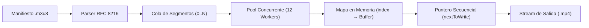

# MyAnimeAnywhere ⚡ (`Steimber/MyAnimeAnywhere`)

<details open>
<summary><b>Español (ES)</b></summary>

Descargador y ensamblador CLI de episodios y flujos de video **HLS (`.m3u8` / RFC 8216)** de alta concurrencia en Node.js para llevar tus capítulos offline a cualquier dispositivo. Utiliza un **pool acotado de 12 workers paralelos** con **vaciado secuencial garantizado en disco**.

---

## ✨ Características Principales

- **Pool de Concurrencia Controlada (`N = 12` workers por defecto)**: Descarga múltiples fragmentos `.ts` en paralelo maximizando el ancho de banda sin saturar los descriptores de red.
- **Escritura Secuencial Garantizada (`nextToWrite` Buffer Map)**: Aunque el fragmento `#8` termine de descargarse antes que el `#5`, los buffers en memoria se vuelcan al archivo `.mp4` de salida en estricto orden secuencial (`0, 1, 2, ...`).
- **Resolución Automática de Master Playlists**: Si el manifiesto `.m3u8` contiene múltiples calidades (`#EXT-X-STREAM-INF`), selecciona automáticamente la variante de mayor resolución/bitrate.
- **Tolerancia a Fallos con Backoff Exponencial**: Reintentos automáticos por segmento ante cortes transitorios de red.
- **Cero Dependencias Externas**: Construido íntegramente sobre APIs nativas de Node.js (`fetch`, `stream`, `fs`, `node:test`).

---

## 🏗️ Arquitectura del Pool Ordenado



---

## 🚀 Uso desde la Terminal (CLI)

```bash
# 1. Descargar desde una URL directa de manifiesto .m3u8:
node src/cli.js --url "https://test-streams.mux.dev/x36xhzz/x36xhzz.m3u8" --out downloads/episodio_01.mp4

# 2. Modo por serie y número de episodio (usando plantilla local en .hlsrc.json):
node src/cli.js --series mi-serie --episode 4 --concurrency 12
```

### Opciones Disponibles

| Opción | Abreviatura | Descripción | Por defecto |
| :--- | :--- | :--- | :--- |
| `--url <url>` | `-u` | URL directa del manifiesto HLS (`.m3u8`) | — |
| `--series <slug>` | `-s` | Identificador de la serie (resuelto vía `.hlsrc.json` local) | — |
| `--episode <num>` | `-e` | Número de episodio para plantilla y nombre de archivo | `1` |
| `--out <ruta>` | `-o` | Ruta del archivo `.mp4` de salida | `downloads/<serie>_ep<XX>.mp4` |
| `--concurrency <n>` | `-c` | Cantidad de workers paralelos | `12` |
| `--retries <n>` | `-r` | Reintentos máximos por segmento con backoff exponencial | `3` |

---

## 🧪 Pruebas Automatizadas

```bash
npm test
```

---

## ⚖️ Uso Aceptable y Alcance Técnico (RFC 8216)

Esta utilidad implementa únicamente el ensamblado de flujos estándar **HTTP Live Streaming (RFC 8216)** no cifrados:
- **No** evade medidas tecnológicas de protección (DRM / TPMs bajo DMCA Sección 1201).
- **No** incluye scrapers, dominios de terceros ni contenido protegido por derechos de autor.
- Está destinada exclusivamente a flujos de dominio público, servidores propios/LAN, contenido con licencia abierta o medios sobre los que el usuario posea autorización.

</details>

<br/>

<details>
<summary><b>English (EN)</b></summary>

Zero-dependency, high-concurrency **HLS (`.m3u8` / RFC 8216)** episodic stream downloader and assembler written in Node.js. Built around a **bounded concurrent worker pool** with **strict in-order sequential buffer flushing**.

---

## ✨ Key Features

- **Bounded Concurrency Pool (`12` workers by default)**: Downloads multiple `.ts` media segments in parallel while bounding memory and socket usage.
- **Strict In-Order Sequential Flushing (`nextToWrite` pointer)**: Out-of-order network completions are buffered in a `Map` and flushed to the output `.mp4` file strictly in sequential order (`0, 1, 2, ...`).
- **Master Playlist Auto-Resolution**: Automatically parses `#EXT-X-STREAM-INF` variants and selects the highest bandwidth/resolution stream.
- **Exponential Backoff Retries**: Per-segment retry logic for resilient downloads over unstable connections.
- **Zero External Dependencies**: Uses native Node.js 18+ APIs (`fetch`, `stream`, `fs`, `node:test`).

---

## 🚀 CLI Usage

```bash
# 1. Download directly from a public .m3u8 manifest URL:
node src/cli.js --url "https://test-streams.mux.dev/x36xhzz/x36xhzz.m3u8" --out downloads/episode_01.mp4

# 2. Episodic mode (using a local git-ignored .hlsrc.json template):
node src/cli.js --series my-series --episode 4 --concurrency 12
```

---

## 🧪 Running Tests

```bash
npm test
```

---

## ⚖️ Acceptable Use & Technical Scope (RFC 8216)

This tool implements standard, unencrypted **HTTP Live Streaming (RFC 8216)** segment assembly only:
- It does **not** circumvent Technological Protection Measures (DRM / TPMs).
- It contains **no** third-party site scrapers, proprietary domain references, or copyrighted media.
- Intended solely for public-domain streams, self-hosted LAN servers, open-licensed media, or streams the user is authorized to archive.

</details>
